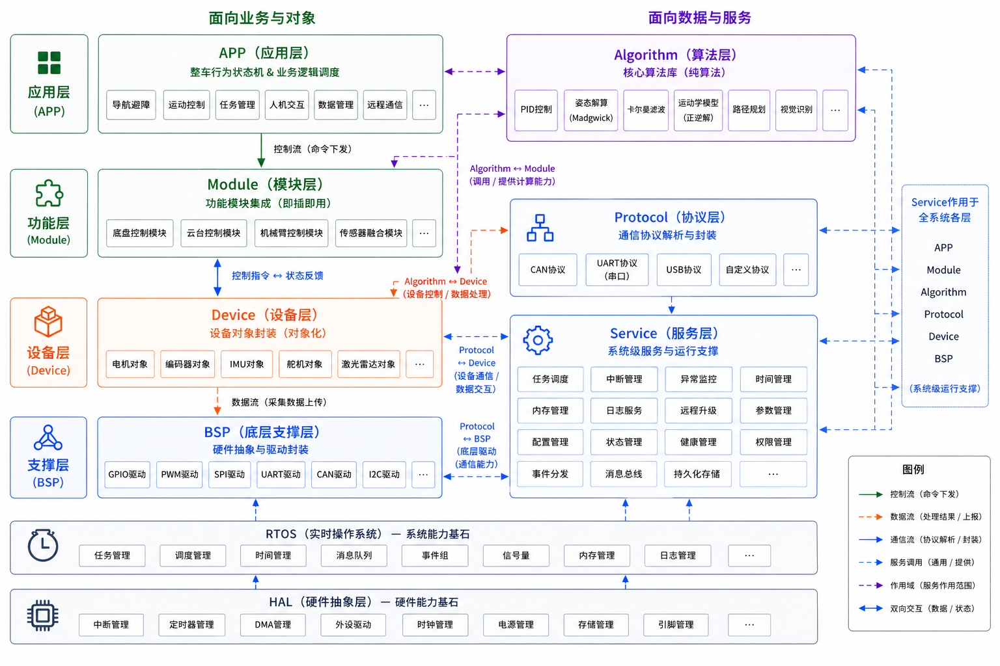

# MSPM0_FreeRTOS_BDC_Core

> TI MSPM0G3519 多层架构主控工程 — 基于 FreeRTOS，面向竞赛与机器人控制场景
>
> MCU：MSPM0G3519 (Cortex-M0+) | SDK：2.10.00.04 | 编译器：ARM GCC (arm-none-eabi) | FreeRTOS：V11.1.0

---

## 目录

- [MSPM0\_FreeRTOS\_BDC\_Core](#mspm0_freertos_bdc_core)
  - [目录](#目录)
  - [1. 分层架构](#1-分层架构)
  - [2. 工程结构](#2-工程结构)
  - [3. 快速上手](#3-快速上手)
    - [3.1 配置 SDK 路径](#31-配置-sdk-路径)
    - [3.2 配置 CMake Presets](#32-配置-cmake-presets)
    - [3.3 首次打开工程](#33-首次打开工程)
    - [3.4 前提条件 Checklist](#34-前提条件-checklist)
  - [4. FreeRTOS 任务总览](#4-freertos-任务总览)
  - [5. 菜单系统](#5-菜单系统)
    - [5.1 菜单树](#51-菜单树)
    - [5.2 按键操作](#52-按键操作)
    - [5.3 事件分发机制](#53-事件分发机制)
  - [6. 编译 / 测试 / 调试](#6-编译--测试--调试)
    - [6.1 编译](#61-编译)
    - [6.2 测试流程](#62-测试流程)
    - [6.3 调试](#63-调试)
    - [6.4 烧录（备用）](#64-烧录备用)
  - [7. SysConfig 引脚配置](#7-sysconfig-引脚配置)
    - [7.1 打开方式](#71-打开方式)
    - [7.2 当前引脚分配（来自 SysConfig）](#72-当前引脚分配来自-sysconfig)
    - [7.3 修改后](#73-修改后)
  - [8. 开发文档](#8-开发文档)

---

## 1. 分层架构

\

```
┌─────────────────────────────────────────────────┐
│                  应用层  App                     │
│       main.cpp / init_task / 各 FreeRTOS 任务    │
├──────────┬──────────┬──────────┬────────────────┤
│  模块层   │  算法层   │  协议层   │    服务层       │
│  Module  │Algorithm │ Protocol │   Service      │
│ OLED菜单  │ PID 控制  │ 串口协议  │ 菜单事件/信号量  │
│          │          │          │ 格式化输出       │
├──────────┴──────────┴──────────┴────────────────┤
│                 设备层  Device                   │
│     外设驱动代理: 电机/陀螺仪/OLED/PCA9555/INS      │
├─────────────────────────────────────────────────┤
│              板级支持层  Bsp                      │
│    UART / PWM / QEI / I2C / CAN / GPIO / KEY    │
├─────────────────────────────────────────────────┤
│         硬件驱动层  TI DriverLib + SysConfig      │
│       MSPM0G3519 (Cortex-M0+) + 外设引脚          │
└─────────────────────────────────────────────────┘
```

> **依赖方向**: 上层依赖下层，下层不感知上层。App → Device/Bsp → DriverLib。
> **Service 层贯穿各层**: 为所有层提供 FreeRTOS 任务调度、菜单事件分发、格式化输出等基础设施。

---

## 2. 工程结构

```txt
root
│  .clang-format             代码格式化配置
│  CMakeLists.txt            顶层 CMake（自动发现 User/ 下所有 .c/.cpp）
│  CMakePresets.json         编译预设（Debug / Release）
│  mspm0g351x_base.cmake     MSPM0 基础配置（编译器 + SDK 路径 + 链接脚本）
│  README.md                 本文件
│
├─.vscode/                   VSCode 配置（launch.json, tasks.json, settings.json）
├─build/                     构建输出（含 compile_commands.json → clangd 智能提示）
├─docs/                      开发文档
│   ├─ 分层规划图.png          分层架构图
│   ├─ 关于配置CMake环境.md    工具链安装 + CMake + clangd 完整配置指南
│   ├─ 编码风格.md             命名规范、缩进、注释等编码约定
│   ├─ CMakePresets.json.txt  CMakePresets 模板
│   └─ mspm0g351x_base.cmake.txt  CMake 基础配置模板
├─Flash/                     烧录脚本（OpenOCD / JLink）
├─FreeRTOS/                  FreeRTOS 内核源码（V11.1.0）
├─SysConfig/                 TI SysConfig 生成文件（自动生成，勿手动改）
└─User/
    ├─App/                   应用层 — main.cpp, main.hpp, task.hpp, test.hpp
    │   └─task/              FreeRTOS 任务实现
    ├─Bsp/                   板级支持层 — UART / PWM / QEI / I2C / CAN / GPIO / KEY
    ├─Device/                设备驱动层 — 电机 / 陀螺仪 / OLED / PCA9555 / INS
    ├─Module/                模块层 — OLED 菜单引擎
    ├─Algorithm/             算法层 — PID 控制器
    ├─Protocol/              协议层 — 串口帧编解码
    └─Service/               服务层 — 菜单事件信号量 / 格式化输出 / FreeRTOSConfig
```

> **User/ 下所有 `.c/.cpp` 会被 CMake 自动发现**，新增文件无需手动修改 CMakeLists.txt。

---

## 3. 快速上手

> 前提：已安装 ARM GCC 交叉编译器 + CMake + VSCode（含 CMake Tools 插件）。
> 完整环境搭建指南见 **[docs/关于配置CMake环境.md](docs/关于配置CMake环境.md)**。

### 3.1 配置 SDK 路径

复制 `docs/mspm0g351x_base.cmake.txt` → 重命名为 `mspm0g351x_base.cmake`（放在工程根目录），按本机路径修改：

```cmake
set(MSPM0_SDK_PATH  /home/rh/ti/mspm0_sdk_2_10_00_04)   # ← 改成你的路径
```

### 3.2 配置 CMake Presets

复制 `docs/CMakePresets.json.txt` → 重命名为 `CMakePresets.json`（放在工程根目录），按你的编译器路径修改 `CMAKE_C_COMPILER` / `CMAKE_CXX_COMPILER`。

### 3.3 首次打开工程

1. **删除** 原有 `build/` 目录（如果有）
2. VSCode 状态栏 CMake 图标 → 选择 **Debug** preset → 配置
3. 等待 CMake 配置完成 → `F7` 编译

### 3.4 前提条件 Checklist

| 项目 | 说明 | 验证命令 |
|------|------|---------|
| ARM GCC | 交叉编译器 | `arm-none-eabi-gcc --version` |
| CMake | ≥ 3.27 | `cmake --version` |
| MSPM0 SDK | 2.10.00.04 | 检查 `mspm0g351x_base.cmake` 中路径 |
| VSCode 插件 | CMake Tools, clangd, Cortex-Debug | — |
| OpenOCD | 0.12+ (烧录/调试) | `openocd --version` |
| JLink | 任意版本 (推荐烧录) | `JLinkExe -Version` |

---

## 4. FreeRTOS 任务总览

系统启动流程：

```
main()
  ├─ SYSCFG_DL_init()   硬件初始化（时钟/GPIO/外设寄存器）
  ├─ bsp_init()         BSP 驱动对象绑定 + NVIC 使能
  ├─ xTaskCreate(init_task) 创建启动任务（优先级 7）
  └─ vTaskStartScheduler()  启动调度器
       │
       └─ init_task 运行（优先级 7，最高）
            ├─ protocol_init()        协议层初始化
            ├─ device_init()          设备层初始化
            ├─ menu_event_init()      菜单事件信号量创建
            ├─ xTaskCreate(...) × 8   创建所有正式任务
            └─ vTaskDelete(NULL)      自删除
```

| 任务名 | 优先级 | 栈 | 周期 | 功能 |
|--------|:------:|-----|------|------|
| `init_task` | 7 | 0x400 | 一次性 | 外设初始化 + 创建所有任务 → 自删除 |
| `track_task` | 7 | 0x100 | 10ms | 巡线传感器读取 (PCA9555, I2C1) |
| `motor_task` | 7 | 0x200 | 10ms | 双电机编码器读取 + PID 速度闭环 |
| `gpio_task` | 4 | 0x100 | 50ms | 三按键轮询 + 蜂鸣器 + LED 心跳 |
| `gyro_task` | 4 | 0x100 | 阻塞 | 陀螺仪姿态数据接收 (UART1) |
| `menu_task` | 3 | 0x200 | 200ms | OLED 3 级菜单 + 事件分发 |
| `debug_print_task` | 3 | 0x100 | 50ms | 菜单事件信号量测试（串口打印） |
| `cpu_monitor_task` | 2 | 0x100 | 500ms | CPU 空闲率监控 |

> 优先级范围 0~7，7 最高，0 最低（空闲任务占 1）。

---

## 5. 菜单系统

### 5.1 菜单树

```
Main Menu
├── Motor             电机控制
│   ├── Start Motor    启动电机
│   ├── Stop Motor     停止电机
│   ├── Set Speed      设定速度 (0~100 转/秒)
│   ├── Mtr Print ON   电机数据打印开
│   └── Mtr Print OFF  电机数据打印关
├── Debug             调试打印
│   ├── Gyro Prt ON/OFF   陀螺仪打印开关
│   ├── Track Prt ON/OFF  巡线打印开关
│   ├── CPU Prt ON/OFF    CPU 打印开关
│   └── Print ALL ON     一键全开
└── Control           控制模式
    ├── Line Ctrl ON/OFF  循线控制开关
    └── Back              返回
```

### 5.2 按键操作

| 按键 | 短按 | 长按 |
|------|------|------|
| KEY1 (PB8) | UP / 数值+ | — |
| KEY2 (PA8) | DOWN / 数值- | — |
| KEY3 (PA31) | ENTER / 确认 | HOME (回首页) |

短按蜂鸣 100ms，长按蜂鸣 300ms。

### 5.3 事件分发机制

```
菜单 K3 确认
  → menu_action()  →  menu_event_give(event_bit)
  → xSemaphoreGive(g_menu_sems[idx])     ← 给出二值信号量
  → 消费者任务 xSemaphoreTake(sem, ...)   ← 阻塞等待事件
```

菜单通过 16 个 FreeRTOS 二值信号量 (`g_menu_sems[16]`) 下发事件，各任务独立 `take` 消费。
事件位定义和 API 见 `User/Service/menu_event.hpp`。

---

## 6. 编译 / 测试 / 调试

### 6.1 编译

| 操作 | 方式 |
|------|------|
| 编译 | `F7` 或点击 VSCode 底部 Build 按钮 |
| 清理重建 | `Ctrl+Shift+P` → `CMake: Clean Rebuild` |

CMake 自动发现 `User/` 下所有 `.c/.cpp`，无需手动维护文件列表。

### 6.2 测试流程

> ⚠️ **当前烧录功能不可用**，请使用调试模式下载并运行程序。

**标准测试流程：`F7` → `F5`**

1. `F7` 编译
2. `F5` 启动调试（会自动下载程序到芯片并运行）

| 步骤 | 按键 | 说明 |
|------|------|------|
| 编译 | `F7` | 编译工程 |
| 下载+运行 | `F5` | 通过调试器下载程序并启动 |
| 继续运行 | `F5` | 断点暂停后继续执行 |

### 6.3 调试

`F5` 启动调试，已预配 OpenOCD / JLink 两种调试器（`.vscode/launch.json`）。

| 文件 | 调试器 |
|------|--------|
| `.vscode/launch.json` | Cortex-Debug + OpenOCD / JLink |

> ⚠️ **调试限制**：MSPM0G3519 (Cortex-M0+) 仅支持 **3 个硬件断点**，不能同时设置多个断点。
> 如需观察多个位置，建议使用单步执行或分次调试。

### 6.4 烧录（备用）

> 烧录脚本当前不可用，仅保留参考。

| 工具 | Linux | Windows |
|------|-------|---------|
| JLink | `Flash/JLink_flash.sh` | `Flash/JLink_flash.bat` |
| OpenOCD | `Flash/OpenOCD_flash.sh` | `Flash/OpenOCD_flash.bat` |

---

## 7. SysConfig 引脚配置

### 7.1 打开方式

用 TI SysConfig 工具打开 `SysConfig/MSPM0_FreeRTOS_BDC_Core.syscfg`。

### 7.2 当前引脚分配（来自 SysConfig）

| 外设 | 实例 | 引脚 | 备注 |
|------|------|------|------|
| UART0 | UART0 | PA11(RX) PA10(TX) | 备用串口 |
| UART1 | UART1 | PA9(RX) PA17(TX) | 陀螺仪通信 |
| UART3 | UART3 | PA27(RX) PA14(TX) | 调试输出 (115200 8N1) |
| UART4 | UART4 | PB18(RX) PB17(TX) | 通用串口 / 菜单测试打印 |
| I2C1 | I2C1 | PB3(SDA) PB2(SCL) | 巡线模块 PCA9555 (0x20) |
| I2C2 | I2C2 | PA24(SDA) PA23(SCL) | OLED SSD1306 (0x3C) |
| MCAN0 | CANFD0 | PA13(RX) PA12(TX) | CAN 总线 |
| PWM_A0 | TIMA0 | PA0(CH0) PA1(CH1) PA7(CH2) PA28(CH3) | 双电机 H 桥 (80MHz) |
| QEI0 | TIMG9 | PA3(PHA) PB9(PHB) | 右轮正交编码器 |
| QEI1 | TIMG8 | PB6(PHA) PB7(PHB) | 左轮正交编码器 |
| LED | GPIOA | PA4 | 心跳指示灯 |
| BUZZ | GPIOA | PA2 | 蜂鸣器 |
| KEY1 | GPIOB | PB8 | 按键 1 (菜单 UP) |
| KEY2 | GPIOA | PA8 | 按键 2 (菜单 DOWN) |
| KEY3 | GPIOA | PA31 | 按键 3 (菜单 ENTER/HOME) |
| MEN1 | GPIOA | PA15 | 左轮电机使能 |
| MEN2 | GPIOA | PA16 | 右轮电机使能 |

### 7.3 修改后

修改 SysConfig → `Ctrl+S` 保存 → 自动重新生成 `ti_msp_dl_config.c/h` → 重新编译。

> ⚠️ `ti_msp_dl_config.c/h` 是自动生成的，**禁止手动编辑**。

---

## 8. 开发文档

| 文档 | 说明 |
|------|------|
| [docs/关于配置CMake环境.md](docs/关于配置CMake环境.md) | 工具链安装 + CMake + clangd + 烧录调试 完整指南 |
| [docs/编码风格.md](docs/编码风格.md) | C/C++ 命名规范、缩进、注释、文件组织约定 |
| [Flash/README.md](Flash/README.md) | 烧录脚本使用说明 |
| [docs/User.md](docs/User.md) | 用户层代码说明 |
| [docs/CLAUDE.md](docs/CLAUDE.md) | AI 辅助开发说明 |
